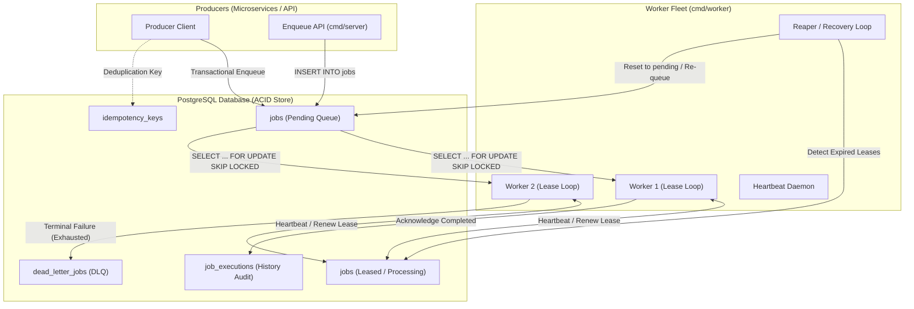
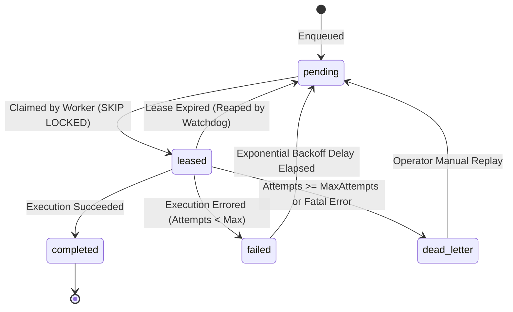

# System Architecture: Reliable Job Engine

`reliable-job-engine` is a production-grade, distributed background job processing system implemented in Go, backed by PostgreSQL. It is engineered specifically for workloads where job loss, unhandled worker crashes, duplicate side-effects, or unbounded retry storms are unacceptable.

---

## 1. High-Level Architectural Overview

The system consists of three primary conceptual components:

1. **Job Producers**: Application microservices or API clients that enqueue persistent job specifications into PostgreSQL within existing ACID transactions or via the engine's enqueue API.
2. **PostgreSQL Storage Engine**: The single source of truth managing durable job state, row-level locks, execution history, lease deadlines, and dead-letter partitions.
3. **Worker Fleet**: Stateless Go worker processes running concurrent execution loops that atomically claim jobs, heartbeat active leases, execute handlers, and acknowledge terminal states.



---

## 2. PostgreSQL Storage Engine and Schema Invariants

Unlike in-memory queues (such as Redis-based brokers) where power failures, network partitions, or replication lag can result in lost or orphaned messages, `reliable-job-engine` uses PostgreSQL's Write-Ahead Log (WAL) and Multi-Version Concurrency Control (MVCC) to ensure zero data loss.

### The Job State Machine

Every job transitions through well-defined, strictly guarded states:



### Table Structure & State Representation

- `jobs`: Stores the primary queue records with payload, execution metadata, current state, priority, retry counters, and lease ownership.
- `job_executions`: Append-only audit log recording every single attempt by worker ID, duration, error trace, and timestamp.
- `dead_letter_jobs`: Quarantined table containing exhausted or corrupted jobs, preserving original payloads, failure stack traces, and operator replay metadata.
- `idempotency_keys`: Dedup table mapping idempotency keys to completed job results, preventing re-execution of identical operations.

---

## 3. Atomic Job Claiming: `SELECT FOR UPDATE SKIP LOCKED`

To achieve high concurrency across dozens of parallel worker instances without table-level locking bottlenecks or race conditions, the engine uses PostgreSQL's row-level locking feature:

```sql
WITH claimable AS (
    SELECT id
    FROM jobs
    WHERE state = 'pending'
      AND scheduled_at <= NOW()
    ORDER BY priority DESC, scheduled_at ASC
    LIMIT $1
    FOR UPDATE SKIP LOCKED
)
UPDATE jobs
SET state = 'leased',
    worker_id = $2,
    lease_expires_at = NOW() + $3::interval,
    fencing_token = fencing_token + 1,
    updated_at = NOW()
FROM claimable
WHERE jobs.id = claimable.id
RETURNING jobs.id, jobs.queue, jobs.payload, jobs.attempt, jobs.fencing_token, jobs.lease_expires_at;
```

### Why `SKIP LOCKED` Is Critical:
1. **Zero Contention**: Workers do not block waiting for other workers to release locks. If a row is locked by Worker A, Worker B instantly skips it and claims the next available candidate.
2. **Deterministic Priority**: Jobs are ordered by `priority DESC` and `scheduled_at ASC`, ensuring that critical tasks execute first and scheduled delays are respected.
3. **Atomicity**: The CTE selects and locks rows, while the outer `UPDATE` sets the lease and returns the claimed rows within a single atomic statement.

---

## 4. Worker Leases, Heartbeats, and Fencing Tokens

### Lease Mechanics
When a worker claims a job, it acquires a **time-bounded lease** (e.g., 30 seconds). The worker is expected to finish execution before `lease_expires_at`.

### Heartbeat Renewal
For long-running jobs, a background Go goroutine within the worker sends periodic heartbeat updates:
```sql
UPDATE jobs
SET lease_expires_at = NOW() + $1::interval,
    updated_at = NOW()
WHERE id = $2
  AND worker_id = $3
  AND fencing_token = $4
  AND state = 'leased';
```

### Fencing Tokens (Zombie Worker Protection)
Distributed systems suffer from garbage collection pauses, network latency spikes, or temporary process freezes. If Worker A freezes for 40 seconds:
1. Worker A's lease expires (`lease_expires_at < NOW()`).
2. The Reaper process resets the job state to `pending`.
3. Worker B claims the job and increments `fencing_token` from `4` to `5`.
4. Worker A unfreezes and attempts to acknowledge completion or update database state.
5. Worker A's update fails because its query specifies `WHERE fencing_token = 4`. Worker A's stale write is rejected, preventing split-brain corruption.

---

## 5. Exponential Backoff and Full Jitter

When a job handler returns a transient error and `attempt < max_attempts`, the job enters the `failed` state and is rescheduled with an exponential backoff delay.

### Formula (Full Jitter)
To prevent the "thundering herd" problem and avoid retry storms synchronizing against downstream databases:

$$\text{sleep} = \min(\text{MaxBackoff}, \text{BaseBackoff} \times 2^{\text{attempt}})$$
$$\text{delay} = \text{random\_uniform}(0, \text{sleep})$$

Where:
- $\text{BaseBackoff}$: Default 1 second.
- $\text{MaxBackoff}$: Default 300 seconds (5 minutes).
- $\text{random\_uniform}(0, \text{sleep})$: Uniform random distribution ensuring de-synchronized retries.

The next execution time is set to `NOW() + delay`.

---

## 6. Dead-Letter Queue (DLQ) Architecture

When a job exceeds `max_attempts` or fails with an explicit non-retryable error (e.g., invalid payload schema):

1. The job is atomically removed from the active queue and inserted into `dead_letter_jobs`.
2. The complete error message, stack trace, worker ID, and execution duration are preserved.
3. Operators can inspect quarantined jobs via the CLI (`jobctl dlq list`) or HTTP API (`GET /api/v1/dlq`).
4. Once the downstream issue or code defect is resolved, operators can trigger **Manual Replay** (`POST /api/v1/dlq/:id/replay`), which atomically re-inserts the job into `jobs` with reset attempts and increments the audit trail.

---

## 7. Delivery Semantics: At-Least-Once vs. Exactly-Once

### At-Least-Once Delivery
In distributed systems subject to arbitrary node crashes and network partitions, physical delivery guarantees can only be **At-Least-Once**. If a worker completes an external side effect (e.g., charging a payment gateway) and crashes immediately before acknowledging the job in PostgreSQL, another worker will eventually re-execute the job.

### Achieving Exactly-Once Processing via Idempotency
To prevent duplicate side-effects:
1. **Idempotency Keys**: Producers provide a unique `idempotency_key` (e.g., `invoice_req_98a72f`).
2. **Transactional Outbox / Idempotency Table**: Handlers execute business logic inside a database transaction that simultaneously writes the business result and records the `idempotency_key` in the `idempotency_keys` table.
3. If a duplicate delivery occurs, the worker checks the idempotency table, recognizes the task has already been processed, and acknowledges the job immediately without re-executing side effects.

---

## 8. Observability and Telemetry

The architecture incorporates first-class observability:

- **Structured Logging**: Uses Go's standard library `log/slog` outputting JSON with contextual keys: `job_id`, `queue`, `worker_id`, `attempt`, `fencing_token`, and `duration_ms`.
- **Prometheus Metrics**: Exposes vital indicators at `/metrics`:
  - `jobs_enqueued_total{queue}`
  - `jobs_completed_total{queue, worker_id}`
  - `jobs_failed_total{queue, reason}`
  - `jobs_dead_lettered_total{queue}`
  - `job_execution_duration_seconds{queue}` (Histogram)
  - `queue_depth{queue, state}` (Gauge)
  - `active_leases_count{queue}` (Gauge)
- **Queue Inspection**: The engine provides both a lightweight CLI (`cmd/cli`) and HTTP server (`cmd/server`) allowing operators to query in-flight leases, queue backlog, and DLQ status in real time.
