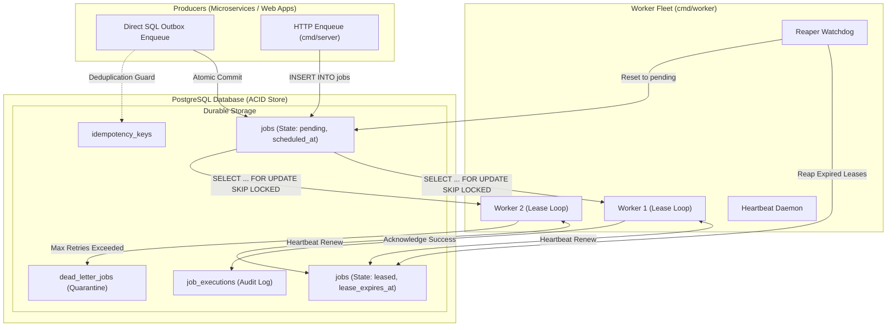
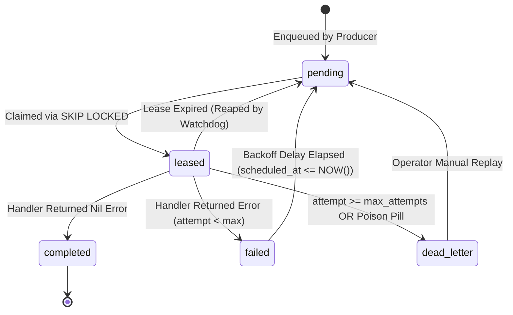

# Reliable Job Engine (`reliable-job-engine`)

> **A fault-tolerant distributed background job processing engine built with Go and PostgreSQL, featuring durable queues, worker leases, exponential retries, idempotent execution, and dead-letter recovery.**

[](LICENSE)
[](https://go.dev/)
[](https://www.postgresql.org/)
[](https://github.com/MRINALPRAKASHFSD/Job_Queue-/actions/workflows/ci.yml)
[](CHANGELOG.md)

---

## Table of Contents

- [1. Introduction](#1-introduction)
- [2. Problem Statement](#2-problem-statement)
- [3. Why This Project Exists](#3-why-this-project-exists)
- [4. Core Features](#4-core-features)
- [5. Architecture Overview](#5-architecture-overview)
- [6. Technology Stack](#6-technology-stack)
- [7. Project Structure](#7-project-structure)
- [8. Installation Prerequisites](#8-installation-prerequisites)
- [9. Local Development Setup](#9-local-development-setup)
- [10. Docker Setup](#10-docker-setup)
- [11. Configuration & Environment Variables](#11-configuration--environment-variables)
- [12. Running the Server](#12-running-the-server)
- [13. Running Workers](#13-running-workers)
- [14. CLI Usage (`jobctl`)](#14-cli-usage-jobctl)
- [15. API Documentation](#15-api-documentation)
- [16. Reliability Guarantees](#16-reliability-guarantees)
- [17. Retry and Backoff Strategy](#17-retry-and-backoff-strategy)
- [18. Lease and Visibility Timeout Explanation](#18-lease-and-visibility-timeout-explanation)
- [19. Dead-Letter Queue (DLQ) Explanation](#19-dead-letter-queue-dlq-explanation)
- [20. Idempotency Strategy](#20-idempotency-strategy)
- [21. Testing Instructions](#21-testing-instructions)
- [22. Security Considerations](#22-security-considerations)
- [23. Performance Benchmarking Methodology](#23-performance-benchmarking-methodology)
- [24. Roadmap](#24-roadmap)
- [25. Contributing Guidelines](#25-contributing-guidelines)
- [26. License and Copyright](#26-license-and-copyright)
- [27. Author Information](#27-author-information)

---

## 1. Introduction

`reliable-job-engine` is an open-source distributed background job execution platform written in Go, utilizing PostgreSQL as an ACID-compliant durable storage layer. 

Background processing in production microservices often carries high business risk: financial transactions, customer notifications, outbound webhook delivery, report compilation, and data pipeline ETL. `reliable-job-engine` is designed to guarantee that jobs are never lost, worker crashes are recovered automatically without human intervention, duplicate executions are short-circuited via idempotency keys, and poison pill payloads are safely quarantined.

---

## 2. Problem Statement

Modern distributed applications frequently encounter severe background processing failure modes when relying on ephemeral or simplistic queue mechanisms:

1. **Silent Job Loss**: In-memory message brokers (e.g., standard Redis configurations) risk dropping unpersisted queue items during abrupt server restarts, memory evictions, or replication lag.
2. **Zombie Workers and Split-Brain Execution**: A worker node subjected to CPU starvation, GC pauses, or temporary network partitions may lose connectivity. If another worker assumes the lease while the original worker continues running, both workers mutate external state concurrently.
3. **Thundering Herd & Retry Storms**: When downstream services experience transient outages, naïve fixed-interval retries cause thousands of workers to strike the downstream service simultaneously, preventing recovery.
4. **Poison Pill Paralysis**: A malformed message that crashes a worker upon receipt will cyclically re-enter the queue and crash every worker in the fleet in cascade.
5. **Two-Phase Commit Impedance**: Decoupling the database transaction from message enqueueing creates dual-write vulnerabilities (the database transaction succeeds, but message publishing fails, or vice versa).

---

## 3. Why This Project Exists

Many teams default to heavy messaging infrastructures (RabbitMQ, Apache Kafka, AWS SQS) or ephemeral Redis-based job queues (Sidekiq, Celery, BullMQ). While suitable for high-throughput streaming, they introduce substantial operational complexity and fail to solve transactional atomicity with core application data.

By engineering on top of **PostgreSQL** with modern row-level lock primitives (`SELECT ... FOR UPDATE SKIP LOCKED`), `reliable-job-engine` delivers:

- **Zero Dual-Write Hazard**: Jobs can be scheduled within the exact same database transaction as core domain models (e.g., creating an order record and enqueuing its fulfillment job in one atomic commit).
- **Rock-Solid ACID Durability**: PostgreSQL's Write-Ahead Log (WAL) ensures jobs are durable the instant they are enqueued.
- **Strict Concurrency Control**: `SKIP LOCKED` prevents lock contention across arbitrary worker nodes without distributed coordination overhead (e.g. ZooKeeper, etcd).
- **Reduced Infrastructure Surface**: No auxiliary broker clusters to deploy, patch, monitor, or back up.

---

## 4. Core Features

The engine's capabilities are organized into sequential milestones:

- **Atomic Job Claiming** `[Planned - Phase 2]`: Non-blocking claiming using PostgreSQL `SELECT FOR UPDATE SKIP LOCKED`.
- **Durable Priority Queues** `[Planned - Phase 2]`: Support for arbitrary named queues and integer priorities (`Critical`, `High`, `Default`, `Low`).
- **Delayed & Scheduled Jobs** `[Planned - Phase 2]`: Precision execution timestamps (`scheduled_at`).
- **Worker Leases & Fencing Tokens** `[Planned - Phase 3]`: Time-bounded worker ownership with monotonically incrementing fencing tokens to disarm zombie workers.
- **Heartbeat Daemon** `[Planned - Phase 3]`: Background lease extension for long-running batch operations.
- **Reaper / Crash Recovery** `[Planned - Phase 3]`: Autonomous watchdog process resetting abandoned jobs to `pending`.
- **Full Jitter Exponential Backoff** `[Implemented - v0.1.0]`: Mathematical backoff algorithms de-synchronizing retries to shield downstream dependencies.
- **Dead-Letter Quarantine (DLQ)** `[Planned - Phase 4]`: Automatic isolation of exhausted jobs with full stack trace retention and manual replay APIs.
- **Transactional Idempotency** `[Planned - Phase 5]`: Deduplication keys and transactional outbox compatibility to guarantee exactly-once business side effects.
- **Telemetry & Inspection** `[Planned - Phase 6]`: Structured logging via Go `log/slog`, Prometheus metrics, and CLI inspection tooling.

---

## 5. Architecture Overview

### High-Level Architecture



### Job Lifecycle State Machine



---

## 6. Technology Stack

- **Primary Language**: Go 1.24+ (Standard library, `database/sql`, `log/slog`, context-driven cancellation).
- **Durable Storage**: PostgreSQL 15+ / 16+ (Utilizing `jsonb`, row-level locks, and partial indexes).
- **Containerization**: Docker (Multi-stage build) & Docker Compose.
- **CI/CD & DevSecOps**: GitHub Actions, GitHub CodeQL, Dependabot, and Dependency Review.
- **Build System**: GNU Make.

---

## 7. Project Structure

```
reliable-job-engine/
├── cmd/
│   ├── server/               # HTTP API server & healthcheck daemon
│   │   └── main.go
│   ├── worker/               # Worker pool daemon
│   │   └── main.go
│   └── cli/                  # jobctl administrative CLI
│       └── main.go
├── internal/
│   ├── config/               # Environment configuration loader & validation
│   │   ├── config.go
│   │   └── config_test.go
│   ├── database/             # PostgreSQL connection pool & transaction wrappers
│   │   └── postgres.go
│   ├── queue/                # Core job domain types, states, priorities, contracts
│   │   └── job.go
│   ├── worker/               # Worker pool, lease tracking, router contracts
│   │   └── worker.go
│   ├── retry/                # Exponential backoff & jitter algorithms
│   │   ├── backoff.go
│   │   └── backoff_test.go
│   ├── dlq/                  # Dead-letter queue inspection & replay models
│   │   └── dlq.go
│   ├── idempotency/          # Deduplication keys & state models
│   │   └── idempotency.go
│   ├── inspector/            # Observability & backlog statistics queries
│   │   └── inspector.go
│   └── api/                  # REST routing, probes, and responses
│       └── router.go
├── migrations/
│   ├── 000001_init_schema.up.sql    # Core tables, partial indexes, constraints
│   └── 000001_init_schema.down.sql  # Schema rollback
├── tests/
│   ├── unit/                 # Unit test suite
│   │   └── unit_test.go
│   └── integration/          # PostgreSQL container integration test suite
│       └── integration_test.go
├── docs/
│   └── diagrams/             # Standalone Mermaid architecture diagrams
│       ├── architecture.mermaid
│       └── job_lifecycle.mermaid
├── scripts/
│   ├── setup_dev.sh          # Local developer bootstrap script
│   └── migrate.sh            # Migration execution script
├── .github/
│   ├── workflows/            # CI, CodeQL, Dependency Review, Release
│   ├── ISSUE_TEMPLATE/       # Structured bug & feature templates
│   ├── PULL_REQUEST_TEMPLATE.md
│   ├── CODEOWNERS
│   └── dependabot.yml
├── Makefile                  # Local automation targets
├── Dockerfile                # Secure multi-stage container build
├── docker-compose.yml        # Local development cluster
├── .env.example              # Sanitized configuration template
├── README.md
├── LICENSE
├── NOTICE
├── CONTRIBUTING.md
├── CODE_OF_CONDUCT.md
├── SECURITY.md
├── CHANGELOG.md
├── ARCHITECTURE.md
├── FAILURE_MODES.md
└── ROADMAP.md
```

---

## 8. Installation Prerequisites

Before running `reliable-job-engine`, ensure your development workstation has:

- **Go**: Version 1.24 or higher ([Installation Guide](https://go.dev/doc/install)).
- **PostgreSQL**: Version 15 or higher (or Docker).
- **Docker & Docker Compose**: For containerized database and worker orchestration.
- **GNU Make**: For task automation.

---

## 9. Local Development Setup

1. **Clone the repository**:
   ```bash
   git clone https://github.com/MRINALPRAKASHFSD/Job_Queue-.git
   cd Job_Queue-
   ```

2. **Initialize Environment Configuration**:
   ```bash
   cp .env.example .env
   ```
   *(Review `.env` to adjust database credentials or ports if necessary).*

3. **Start PostgreSQL via Docker Compose**:
   ```bash
   make docker-up
   ```

4. **Apply Database Migrations**:
   ```bash
   make migrate-up
   ```

5. **Verify Code Quality & Tests**:
   ```bash
   make all
   ```

---

## 10. Docker Setup

To run the entire ecosystem (PostgreSQL, API Server, and Worker Fleet) fully containerized:

```bash
# Build container images
make docker-build

# Launch all services in background
docker compose up -d

# Inspect running containers
docker compose ps

# View aggregate logs
docker compose logs -f

# Teardown services and volumes
make docker-down
```

---

## 11. Configuration & Environment Variables

All settings are configured via environment variables. Refer to [`.env.example`](.env.example) for exact placeholders.

| Variable | Default Value | Description |
| :--- | :--- | :--- |
| `APP_ENV` | `development` | Deployment environment (`development`, `staging`, `production`). |
| `APP_DEBUG` | `true` | Enable verbose diagnostic logging. |
| `SERVER_HOST` | `0.0.0.0` | API server listen interface. |
| `SERVER_PORT` | `8080` | API server HTTP port. |
| `DB_HOST` | `127.0.0.1` | PostgreSQL database hostname. |
| `DB_PORT` | `5432` | PostgreSQL database port. |
| `DB_USER` | `postgres` | Database username. |
| `DB_PASSWORD` | `postgres_password_placeholder` | Database password placeholder. |
| `DB_NAME` | `reliable_job_engine` | Database catalog name. |
| `DB_SSLMODE` | `disable` | SSL connection mode (`disable`, `require`, `verify-full`). |
| `WORKER_CONCURRENCY` | `10` | Number of concurrent execution goroutines per worker node. |
| `WORKER_LEASE_DURATION` | `30s` | Time window before unacknowledged jobs expire and are reaped. |
| `WORKER_HEARTBEAT_INTERVAL` | `10s` | Periodic lease renewal frequency for active workers. |
| `RETRY_BASE_BACKOFF` | `1s` | Initial exponential backoff delay. |
| `RETRY_MAX_BACKOFF` | `300s` | Upper ceiling on exponential retry delay. |
| `RETRY_MAX_ATTEMPTS` | `5` | Threshold before moving failing jobs to Dead-Letter Queue. |
| `DLQ_ENABLED` | `true` | Quarantine exhausted jobs to `dead_letter_jobs`. |

---

## 12. Running the Server

The API server hosts health probes, metrics, and administration endpoints:

```bash
# Compile and run natively:
make build-server
./bin/server

# Check health endpoint:
curl -i http://localhost:8080/healthz
```

Expected JSON response:
```json
{
  "status": "pass",
  "version": "0.1.0",
  "commit": "unknown",
  "timestamp": "2026-11-01T00:00:00Z"
}
```

---

## 13. Running Workers

The worker daemon processes jobs from configured queues:

```bash
# Compile and run natively:
make build-worker
./bin/worker
```

Workers respond to standard POSIX signals:
- `SIGINT` / `SIGTERM`: Triggers graceful draining. Workers stop claiming new jobs, allow active jobs to finish within `WORKER_SHUTDOWN_TIMEOUT`, and cleanly exit.

---

## 14. CLI Usage (`jobctl`)

The repository includes `cmd/cli` (`jobctl`), a dedicated operator CLI tool:

```bash
# Build the CLI:
make build-cli

# Print CLI version:
./bin/jobctl version

# Check cluster status:
./bin/jobctl status

# Dead-letter queue commands (Planned Phase 4):
./bin/jobctl dlq list
./bin/jobctl dlq replay --id <job-uuid>
```

---

## 15. API Documentation

The HTTP API runs on port `8080` by default:

| Method | Endpoint | Status | Description |
| :--- | :--- | :--- | :--- |
| `GET` | `/healthz` | **Available** | Liveness probe returning 200 OK and build metadata. |
| `GET` | `/readyz` | **Available** | Readiness probe verifying database connectivity. |
| `GET` | `/api/v1/version` | **Available** | Returns engine version and Git commit hash. |
| `POST` | `/api/v1/jobs` | *Planned (Phase 2)* | Enqueue a new job payload with priority and delay. |
| `GET` | `/api/v1/queues` | *Planned (Phase 6)* | Aggregated queue depths, backlog, and worker counts. |
| `GET` | `/api/v1/dlq` | *Planned (Phase 4)* | List quarantined dead-letter jobs with failure traces. |
| `POST` | `/api/v1/dlq/:id/replay` | *Planned (Phase 4)* | Replay a dead-lettered job back into active queue. |

---

## 16. Reliability Guarantees

1. **At-Least-Once Delivery**: No job is discarded until an authorized worker acknowledges completion with a valid fencing token.
2. **Crash Resilience**: If a worker node crashes or loses power at any instant during execution, the job lease times out and the Reaper safely reschedules it.
3. **Partition Safety via Fencing Tokens**: Stale workers that awaken after an expired lease cannot overwrite new worker state.
4. **Zero Row Contention**: Parallel workers claim jobs via `FOR UPDATE SKIP LOCKED`, preventing database lock queue serialization.

---

## 17. Retry and Backoff Strategy

The engine implements **Full Jitter Exponential Backoff**:

$$\text{sleep} = \min(\text{MaxBackoff}, \text{BaseBackoff} \times 2^{\text{attempt}})$$
$$\text{delay} = \text{random\_uniform}(0, \text{sleep})$$

### Why Jitter Matters:
Without jitter, hundreds of jobs failing during a third-party API outage retry at identical mathematical intervals, creating destructive request spikes. Jitter flattens the retry distribution uniformly across time.

Unit tests for this algorithm are verified in [`internal/retry/backoff_test.go`](internal/retry/backoff_test.go).

---

## 18. Lease and Visibility Timeout Explanation

When a worker claims a job, it is granted an exclusive lease (e.g. 30 seconds).

- **Heartbeat Goroutine**: For operations running longer than 10 seconds, the worker issues heartbeat queries to push `lease_expires_at` forward.
- **Fencing Token Guard**: Every claim increments `fencing_token`. Any subsequent completion or heartbeat query must include `WHERE fencing_token = $token`. If a worker freezes and its lease is revoked, any delayed write will match 0 rows and be rejected safely.

Detailed failure scenarios are documented in [FAILURE_MODES.md](FAILURE_MODES.md).

---

## 19. Dead-Letter Queue (DLQ) Explanation

When a job reaches `RETRY_MAX_ATTEMPTS` or triggers an unrecoverable payload error:
1. It is moved to `dead_letter_jobs`.
2. The complete error message and worker context are preserved.
3. The job stops consuming queue worker bandwidth.
4. Operators can inspect the payload, patch the code or downstream dependency, and trigger manual replay using `jobctl dlq replay --id <uuid>`.

---

## 20. Idempotency Strategy

To bridge the gap between **At-Least-Once Delivery** and **Exactly-Once Processing**:

- Handlers use the `idempotency_keys` table.
- Before executing a non-idempotent side effect (e.g., credit card charge), the worker records the idempotency key in an atomic transaction.
- If a duplicate delivery occurs, the worker detects the existing key and safely skips re-executing the side effect.

---

## 21. Testing Instructions

The repository enforces strict testing standards:

```bash
# Run unit tests
make test-unit

# Run tests with the Go race detector enabled
make test-race

# Run PostgreSQL integration tests (requires running database)
make test-integration
```

All integration tests execute against actual PostgreSQL containers to validate row-level locking behavior.

---

## 22. Security Considerations

- **Parameterized Queries**: All database queries strictly use `$1, $2, ...` parameters. String concatenation in SQL statements is forbidden.
- **Zero Committed Secrets**: `.env`, `.pem`, and private keys are barred via `.gitignore` and CI scanning.
- **Unprivileged Containers**: Docker images run as non-root user `appuser` (UID 10001).
- **Vulnerability Reporting**: See [SECURITY.md](SECURITY.md) for private disclosure instructions.

---

## 23. Performance Benchmarking Methodology

Performance benchmarking is scheduled for **Phase 7** of the roadmap.

### Planned Methodology:
- **Test Harness**: Synthetic load generation using `pgbench` and Go worker concurrency rigs.
- **Key Metrics**:
  - Enqueue latency ($p50$, $p95$, $p99$).
  - Claim throughput (jobs claimed per second under 10 to 100 concurrent workers).
  - Impact of partial index size on high-throughput queue cycling.

*Note: Benchmarks will be published only after implementation and empirical validation. No simulated or artificial benchmark numbers are published.*

---

## 24. Roadmap

See [ROADMAP.md](ROADMAP.md) for complete milestone breakdowns:

- :white_check_mark: **Phase 1: Repository Foundation** (v0.1.0 - Current)
- :hourglass_flowing_sand: **Phase 2: Durable Queue Engine** (v0.2.0)
- :white_circle: **Phase 3: Worker Reliability & Heartbeat** (v0.3.0)
- :white_circle: **Phase 4: Retry & Dead-Letter Queue** (v0.4.0)
- :white_circle: **Phase 5: Transactional Idempotency** (v0.5.0)
- :white_circle: **Phase 6: Observability & Management** (v0.6.0)
- :white_circle: **Phase 7: Advanced Features & Benchmarks** (v1.0.0)

---

## 25. Contributing Guidelines

We welcome community contributions. Please review [CONTRIBUTING.md](CONTRIBUTING.md) for:
- Fork and clone workflows.
- Conventional Commits (`feat(queue): ...`, `fix(worker): ...`).
- Mandatory testing and race detector requirements.

---

## 26. License and Copyright

This project is licensed under the **MIT License**. See [LICENSE](LICENSE) for details.

```
Copyright (c) 2026 Mrinal Prakash
SPDX-License-Identifier: MIT
```

Third-party software notices and attributions are documented in [NOTICE](NOTICE).

---

## 27. Author Information

Created and maintained by **Mrinal Prakash**:
- GitHub: [@MRINALPRAKASHFSD](https://github.com/MRINALPRAKASHFSD)
- Project Repository: [https://github.com/MRINALPRAKASHFSD/Job_Queue-](https://github.com/MRINALPRAKASHFSD/Job_Queue-)
